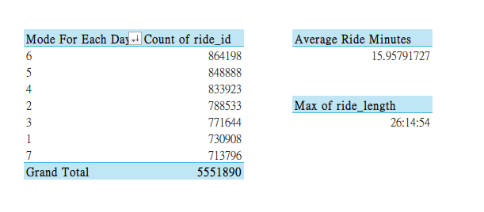
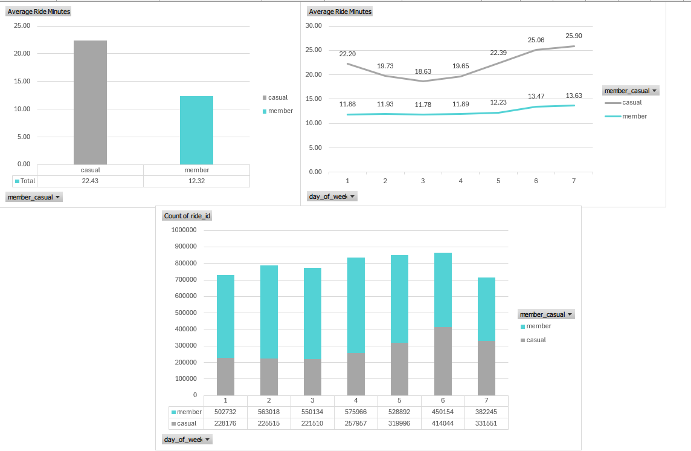
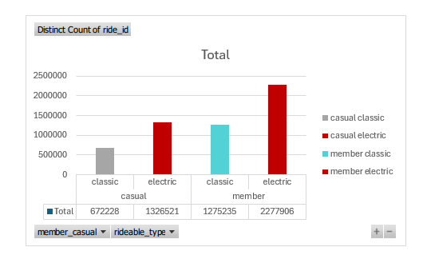
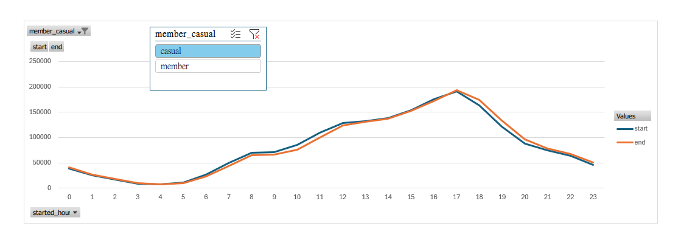
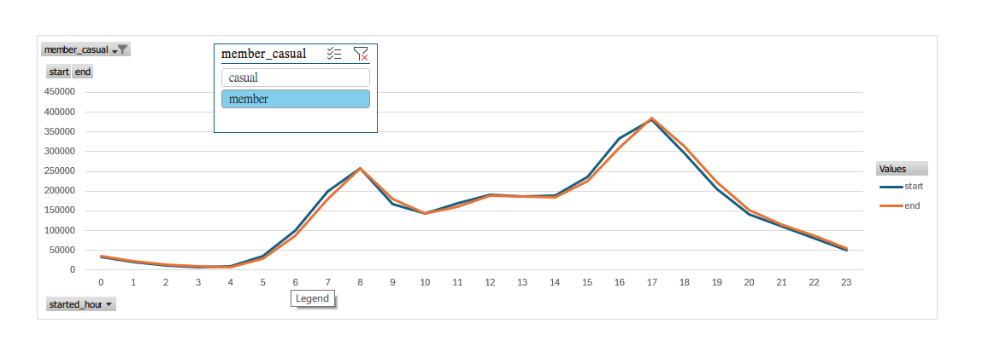
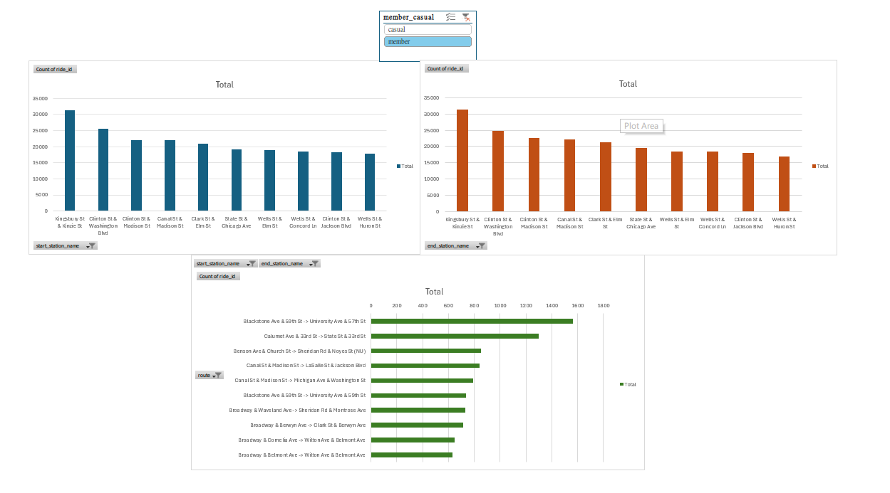
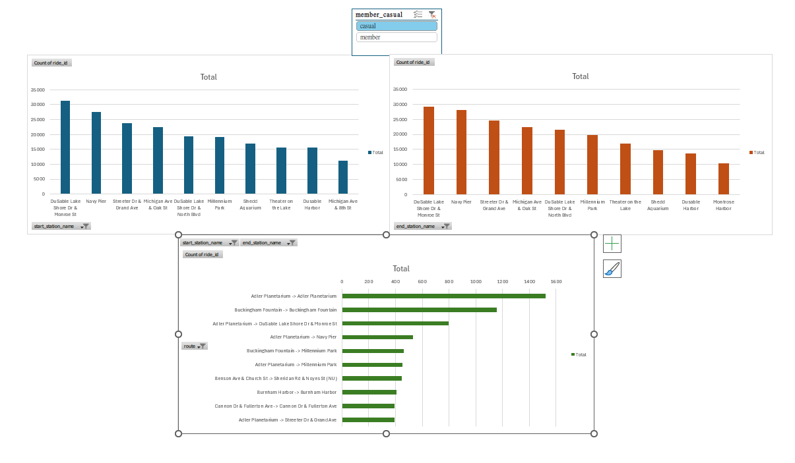

# Cyclistic Bike-Share Analysis

**Role:** Junior Data Analyst  
**Tools:** Microsoft Excel (Power Query and PivotTables) and Python  
**Analysis period:** January–December 2025  
**Status:** Excel analysis complete

## 1. Business Task

My assignment is to compare how members and casual riders use Cyclistic’s bike-share service. I plan to compare ride counts, trip durations, and riding patterns by day of the week and hour of the day. The findings will help Marketing Director Lily Moreno and her team decide which approaches to test first to encourage casual riders to become members.

## 2. Data Sources

This project uses publicly available trip records from Chicago’s Divvy bike-share system as a proxy for the fictional company Cyclistic. The data covers January through December 2025 across 12 CSV files, one per month. Each row represents one trip. The source files are available from the official archive. [Official Divvy data archive](https://divvy-tripdata.s3.amazonaws.com/index.html)

**Data license and privacy.** Divvy publishes anonymized trip records under its data license. I use trips as the unit of analysis. The records do not identify individual riders or allow me to track a rider’s trips over time. [Divvy system data](https://divvybikes.com/system-data) · [Divvy Data License Agreement](https://divvybikes.com/data-license-agreement)

## 3. Data Cleaning and Transformation

I cleaned the **January 2025** data in Excel in the following order.

1. **Add analysis columns.** After opening the file, I added four columns.
   - `ride_length`: I subtracted the start time from the end time and formatted the duration as `[h]:mm:ss`.
   - `day_of_week`: I used `WEEKDAY` on the start time, with Monday coded as 1 and Sunday as 7.
   - `started_hour`: I used Excel’s `HOUR` function on `started_at` (`=HOUR(C2)` when the start timestamp is in column C). The result is an integer from 0 to 23. For example, 17:42 falls in hour 17, which covers 17:00–17:59. This field supports hourly ride comparisons between members and casual riders on weekdays and weekends.
   - `ended_hour`: I used Excel’s `HOUR` function on `ended_at` (`=HOUR(D2)` when the end timestamp is in column D) to record the hour each trip ended, from 0 to 23.
2. **Check for duplicates.** I used **Remove Duplicates** on Excel’s **Data** tab. Excel reported that **zero duplicate records** were removed.
3. **Standardize bike type labels.** I standardized the `rideable_type` labels to `classic` and `electric`.
4. **Standardize timestamp formats.** I formatted `started_at` and `ended_at` to display the date and time using a 24-hour clock.
5. **Review each column using filters.** I selected the full data range, enabled Excel’s **Filter**, and used each column’s dropdown to check categories, blanks, and unusual values. I found trips that began in December 2024 and used `started_at` to remove records outside January 2025. Both station name columns contained blanks. I used Excel’s Filter to check `ride_length`. No durations were negative, and 3 trips displayed as `0:00:00`.

### Cleaning Summary

The January source file contained **138,689 records**. Using `started_at` to assign trips to a month, I removed **53 trips** that began in December 2024 and retained **138,636 trips** that began in January 2025.

| Missing station names among retained trips | Trips |
|---|---:|
| Missing start station name | 22,849 |
| Missing end station name | 24,061 |
| Missing both station names | 9,473 |
| Missing at least one station name (each trip counted once) | 37,437 |

### January–December 2025 Cleaning Summary

I cleaned January first and used that workbook as the template for February through December. I saved one cleaned Excel workbook per month in my local `data_clean` folder.

- I matched January’s 11 columns and their order, added `ride_length`, `day_of_week`, `started_hour`, and `ended_hour`, and applied the same date, duration, and filter settings.
- I changed the bike type labels to `classic` and `electric`.
- I kept trips with missing station names.

The table shows the trip counts before and after cleaning, excluding header rows. I removed **1,075 trips** whose start month did not match their source file and **29 November trips** whose end times were earlier than their start times.

| Source file month | Original trips | Trips removed | Trips after cleaning |
|---|---:|---:|---:|
| January | 138,689 | 53 | 138,636 |
| February | 151,880 | 15 | 151,865 |
| March | 298,155 | 36 | 298,119 |
| April | 371,341 | 11 | 371,330 |
| May | 502,456 | 46 | 502,410 |
| June | 678,904 | 205 | 678,699 |
| July | 763,432 | 102 | 763,330 |
| August | 790,177 | 128 | 790,049 |
| September | 714,759 | 268 | 714,491 |
| October | 646,039 | 71 | 645,968 |
| November | 356,628 | 157 (including 29 trips that ended before they started) | 356,471 |
| December | 140,534 | 12 | 140,522 |
| **Total** | **5,552,994** | **1,104** | **5,551,890** |

### Full-Year Data Assembly and Validation

I used Python to check that the 12 cleaned monthly workbooks had the same 11 columns in the same order, then appended their rows into one CSV. I used Power Query to read the combined CSV, set the column types, and load the results into the Excel Data Model. The full dataset exceeds the **1,048,576-row** limit of a single worksheet. I reopened the workbook and verified that the Data Model contained **5,551,890 trips**, matching the sum of the 12 cleaned files. The PivotTables use this Data Model. [Excel worksheet limits](https://support.microsoft.com/en-us/excel/excel-specifications-and-limits)

## 4. Analysis

[View the interactive dashboard](https://cyclistic-2025-ride-analysis.ovoidparrot33.chatgpt.site) to explore the 2025 results in your browser. You can filter by month, weekday, and rider type. No sign-in or Excel installation is required.

### Overall Ride Activity and Duration

I used an Excel PivotTable to count the **5,551,890** cleaned trips by departure day and to calculate the average and maximum ride durations for 2025.

In my weekday coding, Monday is 1 and Sunday is 7. **Saturday (6)** had the most trips (**864,198**), making it the mode of `day_of_week`. **Sunday (7)** had the fewest trips (**713,796**). Across all trips, the **average ride lasted 15.96 minutes**, and the **longest recorded ride lasted 26 hours, 14 minutes, and 54 seconds**.

These figures describe all riders together. I use them as a baseline for comparing members and casual riders.

### Ride Patterns by Rider Type

I compared the two groups using three Excel charts. They show the overall average ride duration, the average duration by departure day, and the number of trips by departure day. On the weekday axes, 1 is Monday and 7 is Sunday.

Casual riders averaged **22.43 minutes** per trip, compared with **12.32 minutes** for members. Casual riders took longer trips on average every day of the week. Both groups recorded their longest average duration on **Sunday**, at **25.90 minutes** for casual riders and **13.63 minutes** for members.

Members logged more trips than casual riders on every day of the week. Member trips peaked on **Thursday (575,966 trips)**, while casual trips peaked on **Saturday (414,044 trips)**. Weekends accounted for **37.3%** of casual trips and **23.4%** of member trips.

### Bike Type Usage

I compared distinct trip counts by bike type and rider group. Both groups used classic and electric bikes, with more electric trips in each group.

- **Casual riders** took **1,326,521 electric trips (66.37%)** and **672,228 classic trips (33.63%)**. They took about **1.97 times** as many electric trips as classic trips.
- **Members** took **2,277,906 electric trips (64.11%)** and **1,275,235 classic trips (35.89%)**. They took about **1.79 times** as many electric trips as classic trips.

Each percentage is based on the total trips within that rider group.

The trip counts show how often each bike type was used. To assess rider preference, I would need to know how many bikes of each type were available, ideally by location and time. That would let me compare trips per available bike and account for differences in supply.

### Hourly Trip Starts and Returns

I compared the number of trips that started and ended during each hour of the day. The blue line groups trips by start hour, and the orange line groups them by return hour. The two charts use different vertical scales.

**Casual riders.** Trips increased through the morning and afternoon, and both starts and returns peaked during the **5 p.m. hour**. The morning increase was gradual.

**Members.** Starts and returns had a clear morning peak during the **8 a.m. hour**, followed by a larger peak during the **5 p.m. hour**. Both groups were busiest in the late afternoon, and the distinct morning peak stood out among members.

### Most Used Stations and Station Pairs

I ranked named pickup stations, return stations, and start-to-end station pairs by trip count for each rider group. Station pairs show where a trip began and ended. The trip records do not show the path taken between those points.

**Members.** Kingsbury St & Kinzie St ranked first for both pickups and returns. Clinton St & Washington Blvd also ranked highly on both lists. The most common station pair was **Blackstone Ave & 59th St to University Ave & 57th St**.

**Casual riders.** DuSable Lake Shore Dr & Monroe St ranked first for both pickups and returns, followed by Navy Pier. The two most common station pairs were trips that started and ended at **Adler Planetarium** or that started and ended at **Buckingham Fountain**.

#### Missing Station Names and Usable Trips

- Missing start station name: **1,184,500 trips**
- Missing end station name: **1,242,904 trips**
- Both station names missing: **568,146 trips**
- Both station names available for analysis: **3,692,632 trips (66.51% of all trips)**

## 5. Top 3 Recommendations

**Business goal:** Convert more casual riders into members.

### 1. Launch a Ride-Time-Based Membership Plan

**Key findings.** Casual riders averaged **22.43 minutes** per trip, compared with **12.32 minutes** for members. Casual riders took a larger share of their trips on weekends than members did. Member trip starts and returns showed two peaks, one in the **7–9 a.m.** window and a larger one in the **4–6 p.m.** window. The busiest hours were **8 a.m.** and **5 p.m.**, respectively. These patterns are consistent with commuting among members and leisure riding among some casual riders, although trip purpose is unknown. I would test whether the current membership’s value is easier for frequent riders to see than for occasional riders who take longer trips.

**Recommendation.** I recommend launching a membership plan based on the total minutes a rider uses across all trips in a month. Riders could choose a tier that fits the amount of time they expect to ride. This gives people who ride less often but take longer trips a way to choose benefits that match how they use the service.

**Implementation**

- Offer membership tiers with different monthly ride-minute allowances and benefits.
- Give members bonus ride minutes to encourage more riding.
- Add an in-app cost comparison based on a rider’s typical trip length and estimated monthly use. In a hypothetical example, the same monthly spend of 80 units could cover 40 minutes as a casual rider or 60 minutes with membership. That gives members 20 additional minutes for the same spend.
- Promote the plan to casual riders who take longer trips.

**Expected impact.** Showing how membership can offer more ride time for the same spending could help occasional riders see its value and encourage more of them to join. Bonus minutes could also encourage members to ride more often.

### 2. Launch Member Riding Challenges and Rewards

**Key findings.** Weekends accounted for **37.3%** of casual trips and **23.4%** of member trips. Casual riders also had their longest average trips on Saturdays and Sundays. Members showed clear peaks around **8 a.m.** and **5 p.m.** in the overall hourly analysis. These patterns give me two starting points for designing challenges around different riding habits.

**Recommendation.** I recommend launching member-only riding challenges and a points program to give casual riders another reason to join and encourage members to ride more often.

**Implementation**

- **Weekend Riding Challenge:** Let members earn free ride minutes by reaching a cumulative riding-time target on weekends. Run weekly or monthly challenges and promote them to casual riders who ride on weekends.
- **Weekday Evening Points Challenge:** From Monday to Friday, between **5 p.m. and 9 p.m.**, award **1 point** when a member rides for the required number of minutes. Let members redeem **8 points** for extra free ride minutes.

**Expected impact.** The weekend challenge could attract casual riders who mainly ride for leisure. The evening challenge could help riders who mostly ride on weekends develop a more regular weekday riding habit and give members a reason to stay engaged.

### 3. Optimize E-Bike Availability and Offer Exclusive Member Benefits

**Key findings.** The top 10 pickup stations, return stations, and station pairs help identify where each rider group uses the service. **DuSable Lake Shore Dr & Monroe St** and **Navy Pier** led the casual pickup and return rankings. Casual riders took **1.97 times** as many electric trips as classic trips, and members took **1.79 times** as many. These counts show substantial e-bike use. Assessing demand relative to supply requires bike availability data.

**Recommendation.** I recommend reviewing e-bike allocation at stations popular with casual riders and offering members additional e-bike benefits while keeping casual access available.

**Implementation**

- Use casual pickup, return, and station pair rankings to select locations for membership promotion.
- Compare e-bike supply, availability, and use at those locations before adjusting bike allocation.
- Promote member e-bike benefits in the app or at selected stations. Offer extra free e-bike minutes each month or a fee credit.
- Test the offer at a few busy stations and use the conversion results to decide whether to expand it.

**Expected impact.** Checking availability before reallocating bikes could improve how the fleet is distributed at busy stations. Offering member benefits where casual riders already use the service could make membership more valuable to them.

### Evaluation and Limitations

I would start with small A/B tests and compare each offer with a group that did not receive it. I would track four measures:

| Metric | How I would measure it |
|---|---|
| Membership conversion rate | Share of eligible casual riders who purchase a membership during the test period |
| Ride frequency | Change in trips per participating rider after the offer |
| Reward redemption rate | Share of earned rewards that members redeem |
| Incremental revenue after incentive costs | Additional revenue compared with the control group, minus the cost of credits and bonus minutes |

The trip records do not track individual riders over time or provide actual membership prices, bike availability, or incentive costs. Only **66.51%** of trips have both station names for station pair analysis. I would use account, pricing, fleet, and cost data to design the tests and measure whether these offers improve conversion.
